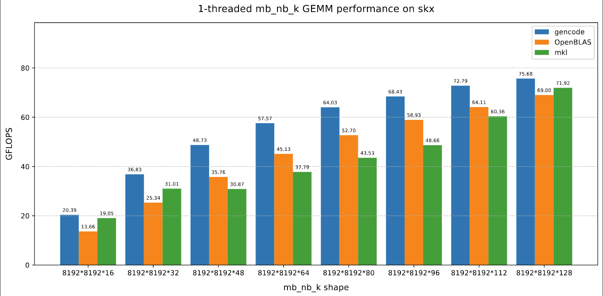
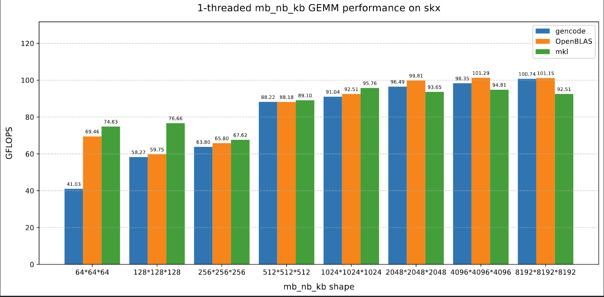
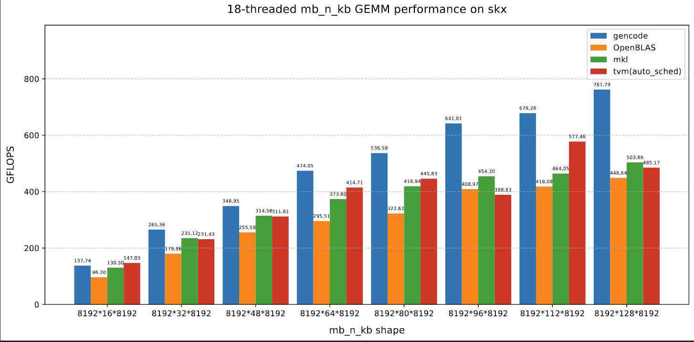
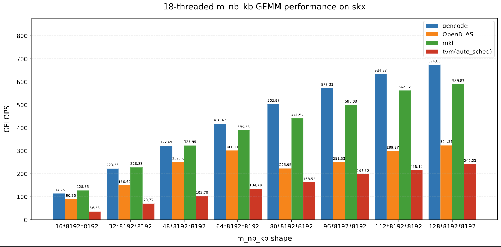
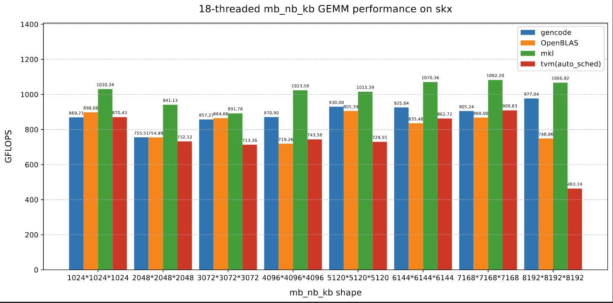

# loopmaster
[en](README_en.md) | [zh](README.md)

在GOTO和BLIS等经典高性能矩阵乘法算法中，通过对矩阵进行分块打包、实现高性能micro kernel与根据cache信息调优分块参数，使大规模方阵矩阵乘法获得了优秀的性能。
在多线程情况下还进行了合作重排，优化在并行时产生的冗余访存。

然而，对于非规则形状的矩阵乘法（也称为异形矩阵乘法，即三个维度M、N、K中有一个或两个维度相对较小）可能需要探索不同的分块策略、循环顺序，以及是否需要对矩阵A、B和C进行数据重排，在多线程情况下还需要考虑线程划分策略与并行方式，这些不同因素的组合手动实现工作量较大。

因此，loopmaster的目标是开发一个支持单线程和多线程场景的矩阵乘法代码生成器，降低开发人员探索不同实现的工作量。同时，它还提供简易的搜索和调优脚本，使用户能够为特定场景选择相对高性能的矩阵乘法代码。
## 特性
- 可支持任意的kernel外嵌套循环顺序
- 并根据循环顺序在相应位置自动插入与循环顺序对应的重排操作
- MN维度嵌套并行，组内线程合作重排
- K维度规约并行
## 构建方法
```bash
mkdir build
cd build
cp ../cmake/config.cmake ./
# Modify configs in config.cmake
cmake ..
make genall -j
make gengemm -j
```
## 代码生成与评测
```bash
cd build
./genall 3 ../gencode/ 1 1 0
sh ../scripts/skx_gengemm.sh
make benchgen -j
make benchgenmt -j
# 最后一个是重复次数，设为0检查计算结果
# 1-threaded
sh ../scripts/benchskxgen.sh ${m} ${n} ${k} ${iter}
# tn-threaded
sh ../scripts/benchskxgenmt.sh ${tn} ${m} ${n} ${k} ${iter}
```
## 定制矩阵乘法示例
命令行：
```bash
cd build
./gengemm W W N 3 MKKN 8192168192 1 ../gencode
```
线程号计算代码片段：
```c++
int tid = omp_get_thread_num();
int tid_m_idx2 = (tid % TN_M_IDX2);
int tid_k_idx1 = ((tid / (TN_M_IDX2)) % TN_K_IDX1);
int tid_k_idx2 = ((tid / (TN_M_IDX2 * TN_K_IDX1)) % TN_K_IDX2);
int tid_n_idx3 = ((tid / (TN_M_IDX2 * TN_K_IDX1 * TN_K_IDX2)) % TN_N_IDX3);
int packa_tid = (tid % PACKA_TN);
int packb_tid = (tid % PACKB_TN);
```
重排操作代码片段：
```c++
const T * packb_src = (B + ((n_idx3) * ldb) + (k_idx2));
T * local_buf_b = (buf_b + (((tid_k_idx2) + (tid_n_idx3 * TN_K_IDX2)) * (std::min(BN2, n) * std::min(BK1, k))));
T * packb_dst = local_buf_b;
int packbn_len3 = bn3;
int packbk_len2 = bk2;
int packbk_idx1_len = (packbk_len2 - 0);
int packbk_idx1_iter_num = ((packbk_idx1_len / BK0) + (((packbk_idx1_len % BK0) > 0) ? 1 : 0));
int packbk_idx1_iter_num_pt = (packbk_idx1_iter_num / PACKB_TN);
int packbk_idx1_iter_num_tail = (packbk_idx1_iter_num % PACKB_TN);
int next_packb_tid = (packb_tid + 1);
int packbk_idx1_local_start = ((((packb_tid <= packbk_idx1_iter_num_tail) ? (packb_tid * (packbk_idx1_iter_num_pt + 1)) : ((packbk_idx1_iter_num_tail * (packbk_idx1_iter_num_pt + 1)) + ((packb_tid - packbk_idx1_iter_num_tail) * packbk_idx1_iter_num_pt))) * BK0) + 0);
int packbk_idx1_local_end = std::min(packbk_len2, ((((next_packb_tid <= packbk_idx1_iter_num_tail) ? (next_packb_tid * (packbk_idx1_iter_num_pt + 1)) : ((packbk_idx1_iter_num_tail * (packbk_idx1_iter_num_pt + 1)) + ((next_packb_tid - packbk_idx1_iter_num_tail) * packbk_idx1_iter_num_pt))) * BK0) + 0));
SyncOn<PACKB_GN, PACKB_TN>(tid, packb_tid, PACKB_SYNC);
T * local_packb_dst = (packb_dst + ((packbk_idx1_local_start - 0) * packbn_len3));
for (int packbk_idx1 = packbk_idx1_local_start; (packbk_idx1 < packbk_idx1_local_end); packbk_idx1 += BK0)
{
    int packbk_len1 = std::min((packbk_len2 - packbk_idx1), BK0);
    for (int packbn_idx2 = 0; (packbn_idx2 < packbn_len3); packbn_idx2 += BN1)
    {
        int packbn_len2 = std::min((packbn_len3 - packbn_idx2), BN1);
        for (int packbn_idx1 = 0; (packbn_idx1 < packbn_len2); packbn_idx1 += BN0)
        {
            int packbn_len1 = std::min((packbn_len2 - packbn_idx1), BN0);
            for (int packbk_idx0 = 0; (packbk_idx0 < packbk_len1); packbk_idx0 += 1)
            {
                int packbk_len0 = std::min((packbk_len1 - packbk_idx0), 1);
                for (int packbn_idx0 = 0; (packbn_idx0 < packbn_len1); packbn_idx0 += 1)
                {
                    int packbn_len0 = std::min((packbn_len1 - packbn_idx0), 1);
                    *local_packb_dst++ = packb_src[(((packbn_idx2 + packbn_idx1 + packbn_idx0) * ldb) + (packbk_idx1 + packbk_idx0))];
                } // packbn_idx0
            } // packbk_idx0
        } // packbn_idx1
    } // packbn_idx2
} // packbk_idx1
SyncOn<PACKB_GN, PACKB_TN>(tid, packb_tid, PACKB_SYNC);
```
## 平台介绍与性能
- [intel xeon gold 6154 arch info](docs/intel_xeon_6154_skylakex.md)  

mnk字母后带b代表此维度较大，大维度固定为8192，下面几张图是方阵和效果比较好的情况。
### 单线程性能
  

### 18线程性能
  
  

## 其它
- [厚实表皮](docs/skin.md)