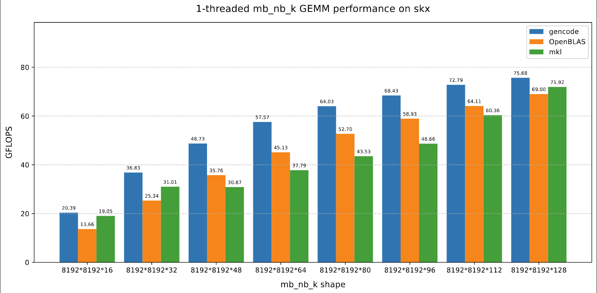
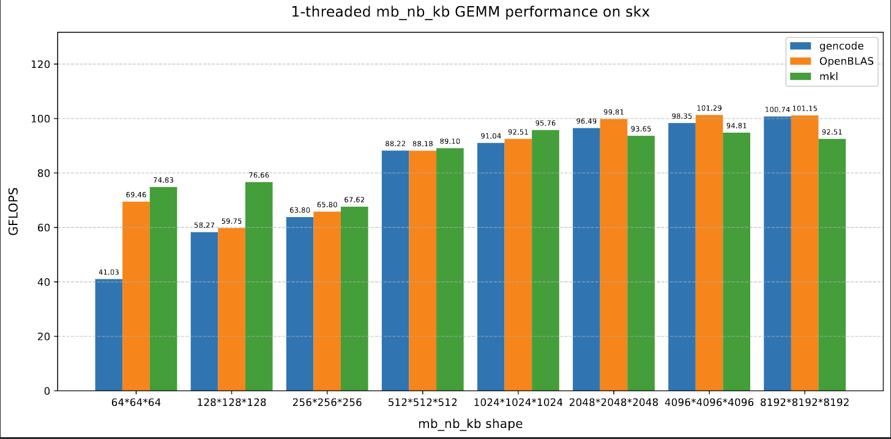
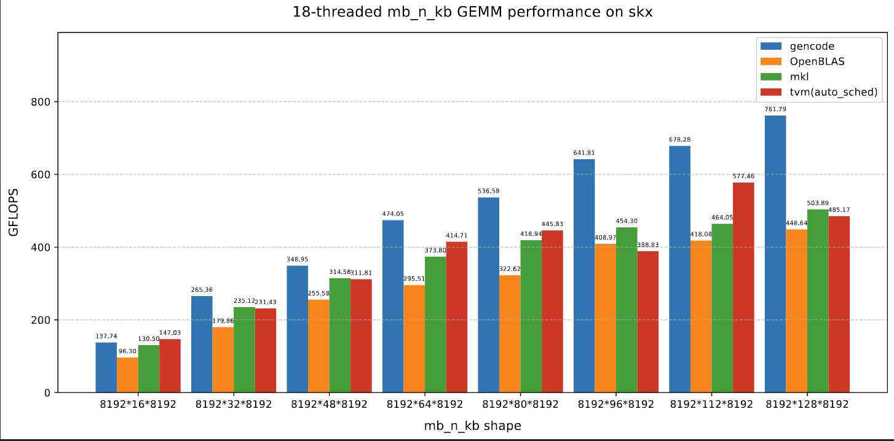
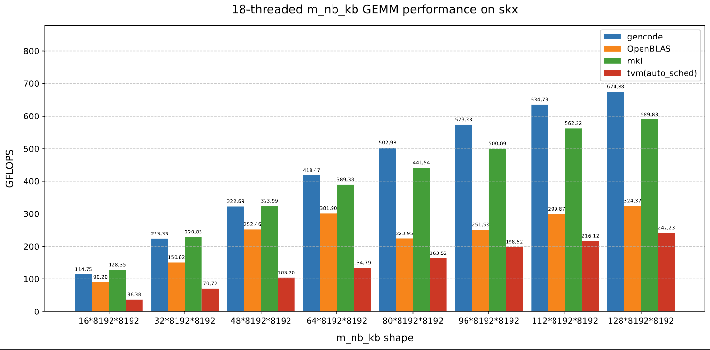
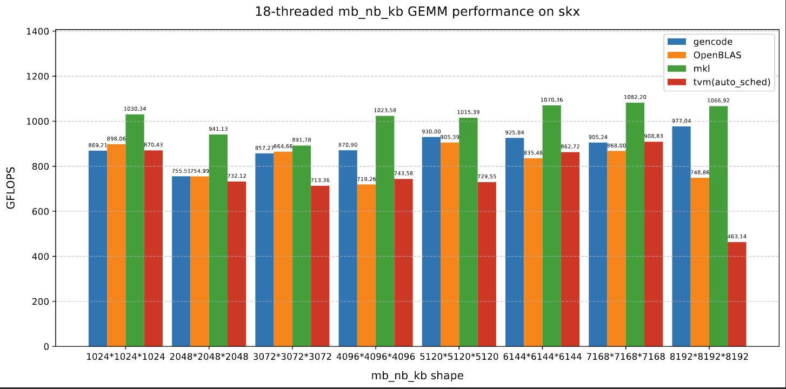

# loopmaster
[en](README_en.md) | [zh](README.md)

In classical high - performance matrix multiplication algorithms like GOTO and BLIS, excellent performance for large - scale square matrix multiplication is achieved through blocking and packing of matrices, implementing high - performance micro - kernels, and tuning blocking parameters according to cache information.
In a multi - thread scenario, cooperative rearrangement is also carried out to optimize the redundant memory access that occurs during parallelism.

However, for non - regular shaped matrix multiplication (also known as irregular matrix multiplication, where one or two of the three dimensions M, N, K are relatively small), it may be necessary to explore different blocking strategies, loop orders, and whether to rearrange matrices A, B, and C. In a multi - thread scenario, the thread - partitioning strategy and parallelization method also need to be considered. Manually implementing combinations of these different factors is quite labor - intensive.

Therefore, the goal of loopmaster is to develop a matrix multiplication code generator that supports both single - thread and multi - thread scenarios, reducing the workload for developers to explore different implementations. At the same time, it also provides simple search and tuning scripts, enabling users to select relatively high - performance matrix multiplication code for specific scenarios.

## Features
- Support any outer-loop order of the kernel.
- Automatically insert data rearrangement operations corresponding to the loop order at the appropriate positions according to the loop order.
- Nested parallelism in the MN dimensions, with threads within the group collaborating for rearrangement.
- Reduction parallelism in the K dimension.

## How to build
```bash
mkdir build
cd build
cp ../cmake/config.cmake ./
# Modify configs in config.cmake
cmake ..
make genall -j
make gengemm -j
```
## Code Generation and Benchmark
```bash
cd build
./genall 3 ../gencode/ 1 1 0
sh ../scripts/skx_gengemm.sh
make benchgen -j
make benchgenmt -j
# The last one is the number of repetitions, set it to 0 to check the calculation result.
# 1-threaded
sh ../scripts/benchskxgen.sh ${m} ${n} ${k} ${iter}
# tn-threaded
sh ../scripts/benchskxgenmt.sh ${tn} ${m} ${n} ${k} ${iter}
```
## Example
command line：
```bash
cd build
./gengemm W W N 3 MKKN 8192168192 1 ../gencode
```
Code snippet for calculating thread number:
```c++
int tid = omp_get_thread_num();
int tid_m_idx2 = (tid % TN_M_IDX2);
int tid_k_idx1 = ((tid / (TN_M_IDX2)) % TN_K_IDX1);
int tid_k_idx2 = ((tid / (TN_M_IDX2 * TN_K_IDX1)) % TN_K_IDX2);
int tid_n_idx3 = ((tid / (TN_M_IDX2 * TN_K_IDX1 * TN_K_IDX2)) % TN_N_IDX3);
int packa_tid = (tid % PACKA_TN);
int packb_tid = (tid % PACKB_TN);
```
Code snippet for rearrangement operation:
```c++
const T * packb_src = (B + ((n_idx3) * ldb) + (k_idx2));
T * local_buf_b = (buf_b + (((tid_k_idx2) + (tid_n_idx3 * TN_K_IDX2)) * (std::min(BN2, n) * std::min(BK1, k))));
T * packb_dst = local_buf_b;
int packbn_len3 = bn3;
int packbk_len2 = bk2;
int packbk_idx1_len = (packbk_len2 - 0);
int packbk_idx1_iter_num = ((packbk_idx1_len / BK0) + (((packbk_idx1_len % BK0) > 0) ? 1 : 0));
int packbk_idx1_iter_num_pt = (packbk_idx1_iter_num / PACKB_TN);
int packbk_idx1_iter_num_tail = (packbk_idx1_iter_num % PACKB_TN);
int next_packb_tid = (packb_tid + 1);
int packbk_idx1_local_start = ((((packb_tid <= packbk_idx1_iter_num_tail) ? (packb_tid * (packbk_idx1_iter_num_pt + 1)) : ((packbk_idx1_iter_num_tail * (packbk_idx1_iter_num_pt + 1)) + ((packb_tid - packbk_idx1_iter_num_tail) * packbk_idx1_iter_num_pt))) * BK0) + 0);
int packbk_idx1_local_end = std::min(packbk_len2, ((((next_packb_tid <= packbk_idx1_iter_num_tail) ? (next_packb_tid * (packbk_idx1_iter_num_pt + 1)) : ((packbk_idx1_iter_num_tail * (packbk_idx1_iter_num_pt + 1)) + ((next_packb_tid - packbk_idx1_iter_num_tail) * packbk_idx1_iter_num_pt))) * BK0) + 0));
SyncOn<PACKB_GN, PACKB_TN>(tid, packb_tid, PACKB_SYNC);
T * local_packb_dst = (packb_dst + ((packbk_idx1_local_start - 0) * packbn_len3));
for (int packbk_idx1 = packbk_idx1_local_start; (packbk_idx1 < packbk_idx1_local_end); packbk_idx1 += BK0)
{
    int packbk_len1 = std::min((packbk_len2 - packbk_idx1), BK0);
    for (int packbn_idx2 = 0; (packbn_idx2 < packbn_len3); packbn_idx2 += BN1)
    {
        int packbn_len2 = std::min((packbn_len3 - packbn_idx2), BN1);
        for (int packbn_idx1 = 0; (packbn_idx1 < packbn_len2); packbn_idx1 += BN0)
        {
            int packbn_len1 = std::min((packbn_len2 - packbn_idx1), BN0);
            for (int packbk_idx0 = 0; (packbk_idx0 < packbk_len1); packbk_idx0 += 1)
            {
                int packbk_len0 = std::min((packbk_len1 - packbk_idx0), 1);
                for (int packbn_idx0 = 0; (packbn_idx0 < packbn_len1); packbn_idx0 += 1)
                {
                    int packbn_len0 = std::min((packbn_len1 - packbn_idx0), 1);
                    *local_packb_dst++ = packb_src[(((packbn_idx2 + packbn_idx1 + packbn_idx0) * ldb) + (packbk_idx1 + packbk_idx0))];
                } // packbn_idx0
            } // packbk_idx0
        } // packbn_idx1
    } // packbn_idx2
} // packbk_idx1
SyncOn<PACKB_GN, PACKB_TN>(tid, packb_tid, PACKB_SYNC);
```
## Platform Introduction and Performance
- [intel xeon gold 6154 arch info](docs/intel_xeon_6154_skylakex.md)  

The letter 'b' after mnk indicates that this dimension is relatively large, and the large dimension is fixed at 8192. The following several figures show the square matrix and the cases with good effects.
### 单线程性能
  

### 18线程性能
  
  

